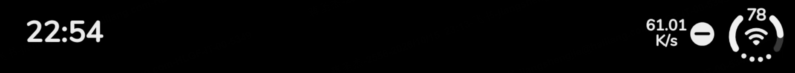
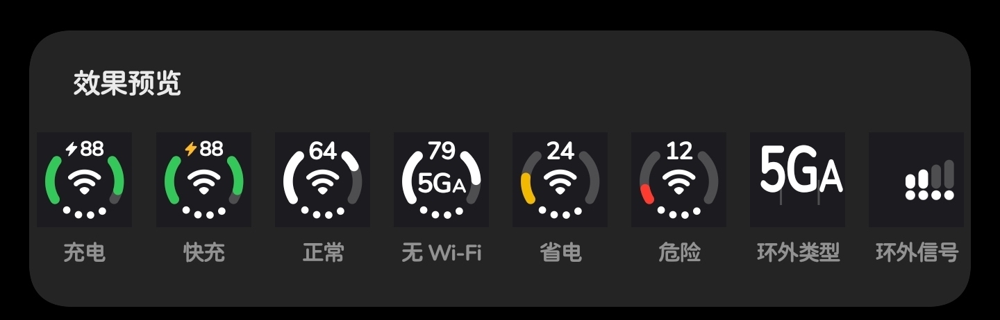
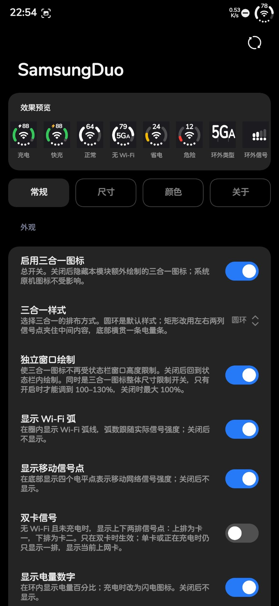
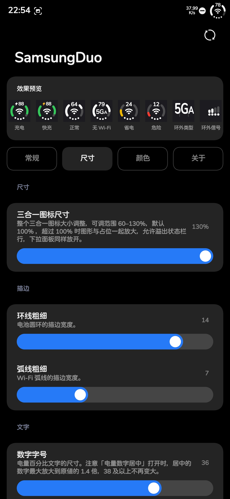
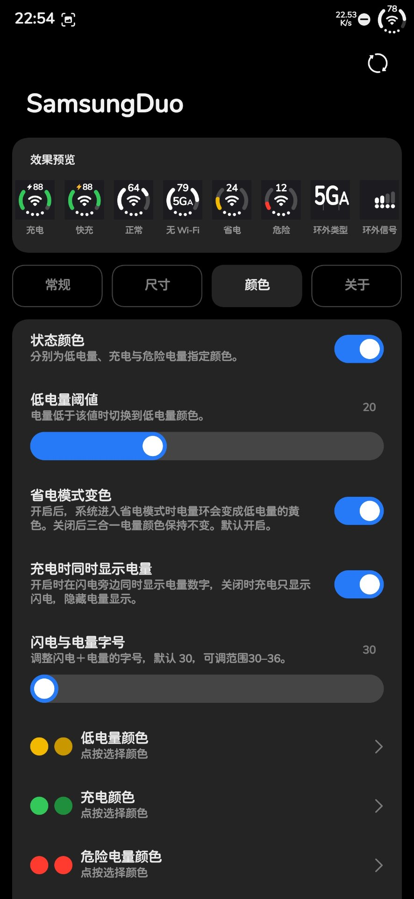

# SamsungDuo

把状态栏里的 **Wi-Fi、移动信号、电量** 合并成一个仿 iPhone「Duo」风格的三合一图标 —— 面向
**三星 One UI 8.5 / Android 16** 的 LSPosed 模块。

作者：**Sunshine丶Jason** · 仓库：[Sunshinejsj/SamsungDuo](https://github.com/Sunshinejsj/SamsungDuo)

> 本项目移植自小米 MIUI 平台的 [HyperDuo](https://github.com/yixing233/HyperDuo)（作者 yixing233），
> 致谢原作者。全部按三星 SystemUI 移植重新实现，详见文末「与上游的差别」。

## 效果

开启后，模块会在系统界面里**额外绘制**一个三合一图标（不替换、不隐藏任何系统原生图标）：

- 外圈是**电池环**，缺口在下方，按电量点亮；
- 环里是 **Wi-Fi 弧线**，弧数跟随真实信号强度；
- 底部是**移动信号点**，四个点表示移动网络信号强度；
- 环内是**电量数字**，充电时变成闪电（快充为琥珀色闪电）。

环外还可以再挂三块陪衬（各自在状态栏里占位）：**信号读数**、**网络类型标签**、**电池温度**。

三处都能显示，各自跟随所在界面的明暗取色：**状态栏、锁屏、下拉通知栏**。





## 安装

1. 从 [Releases](https://github.com/Sunshinejsj/SamsungDuo/releases) 下载最新的 `SamsungDuo-*.apk`
   并安装（需要允许"安装未知应用"）
   > 想直接跳到最新正式版：[releases/latest](https://github.com/Sunshinejsj/SamsungDuo/releases/latest)。
   > Releases 只发正式版；如果还没有可用安装包，可以按 [开发文档](docs/DEVELOPMENT.md) 自行构建。
   > v9.5 起换了签名密钥，与旧版**不同签名、无法覆盖升级**：装过旧版的请先卸载（设置会一起清掉），
   > 再装新版。
2. LSPosed → 模块 → 启用 **SamsungDuo**，作用域选 **系统界面（com.android.systemui）**
3. 重启系统界面（模块里也有"重启系统界面"按钮，需要 root）
4. 打开 App，在设置页逐项调整

设置改完**立即生效**，不需要重启。

## 主要设置

| 分组 | 能调什么 |
|---|---|
| 外观 | 三合一样式（圆环/矩形）、独立窗口绘制、Wi-Fi 弧、移动信号点、双卡信号、电量数字、充电闪电、网络类型（关/环内/环外）、信号位置（环内/环外）、堆叠信号、仅上网卡 |
| 尺寸 | 三合一整体尺寸 60–130%、整组左右平移、整组左侧间距、环外信号大小 |
| 颜色 | 低电量 / 充电 / 危险电量三色（深浅背景分别设）、低电量阈值、省电模式变色 |
| 描边 / 文字 | 环线粗细、弧线粗细、字号、字重、5GA 中 A 的比例、电量数字居中 |
| 电池读数 | 电池温度、温度读数边距、读数尺寸与字重 |
| 充电双显 | 充电时闪电与电量同时显示（左闪电右电量、上下边对齐），字号 30–36 |
| 防烧屏 | 图标微动开关、幅度、周期 |
| 关于 | 检查更新（在线更新）、导出配置、导入配置、查看仓库、调试日志 |

**独立窗口绘制**是「整体尺寸」超过 100% 的钥匙：关着它，三合一挂在状态栏那一行里参与排布，
放大只能放开裁剪、而裁剪对 Android 窗口边界无效，所以最大 100%；开着它，三合一画在自己
的小窗口里，可以把窗口自身加高，于是能调到 100–130%。

## 界面

| 常规 | 尺寸 | 颜色 |
|---|---|---|
|  |  |  |

## 构建

```powershell
# 本机（JDK 21 + Android SDK）
$env:JAVA_HOME = 'C:\Program Files\Eclipse Adoptium\jdk-21.0.12.101-hotspot'
$env:ANDROID_HOME = 'C:\Android\Sdk'
.\gradlew.bat :app:assembleRelease --offline
```

也可以 push 一个 `v*` tag，让 `.github/workflows/build.yml` 在 GitHub 上构建并发布 Release。

## 发布与在线更新

版本号两个数都在 `app/build.gradle.kts`：`versionCode` 与 `versionName`（如 96 / 9.6）。
发版用仓库里的脚本（构建 → aapt2 核对版本 → 打 tag → 建正式 Release → 传 APK）：

```powershell
.\release.ps1 -Version 9.6 -NotesFile .\notes.md
```

App 内的「检查更新」读 `releases/latest`，所以 **tag 必须是 `v` + versionName**（如 `v9.5`）、
Release 必须是正式版（不能是 draft / prerelease）、必须带上 `.apk` 资源。

## 与上游的差别

| | 上游 HyperDuo（MIUI） | 本项目（三星） |
|---|---|---|
| 取色 | MIUI 的暗色图标调度 | hook `DarkIconDispatcher.onDarkChanged`，并**实时读所在界面的探针**，做到下拉取下拉、状态栏取状态栏、锁屏取锁屏 |
| 信号格数 | `getLevel()` | 隐藏 API `SignalStrength.getVendorLevel()`（0–5 级） |
| 快充 | — | 广播 `charger_type`（≥3 为超级快充三档） |
| 挂载点 | 状态栏 | 状态栏 / 锁屏 / 下拉面板三处，各自抢位子挂进系统图标行 |
| 系统图标 | 关开关会交还原生图标 | **从不替换、从不隐藏**任何系统原生图标，模块只是"额外加" |

## 许可

移植自 HyperDuo（MIT）。本项目代码同样以 MIT 发布。
